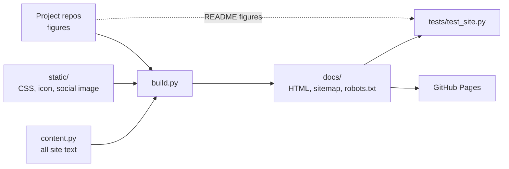

# Arbab Latif: AI Engineering Portfolio Site

The source for [arbablatif.github.io](https://arbablatif.github.io/), a static portfolio of applied AI projects covering RAG, LLM agents, signal processing and fine-tuning. A small Python script generates plain HTML, and GitHub Pages serves it.

## Problem

GitHub repositories are hard to find through general search. Their page titles and metadata are set by GitHub, and a visitor has to read eight long READMEs to understand the work. A portfolio also has to stay accurate: a figure copied by hand can drift away from what the project reports.

## Approach

- **Static HTML, no JavaScript.** Search engines and social previews read the full content straight from the file.
- **One page per project.** Each has its own title, description, canonical URL and social image, so it can rank for its own topic.
- **Structured data.** JSON-LD marks up the author (`Person`), each project (`SoftwareSourceCode`) and the breadcrumbs.
- **One content file.** All text is in `content.py`. `build.py` turns it into pages, a sitemap and `robots.txt`.
- **Checked figures.** A test confirms that every headline figure appears in that project's README.

## Architecture



## Results

From running `python build.py` and `pytest` on Python 3.12:

| Check | Result |
|---|---|
| Pages built | 10 (home, 8 projects, 404) |
| Automated checks | 29 passed |
| Size of `docs/` | 698 KB, including 5 project figures |
| External requests per page | 0 |

The tests cover title and description length, one `h1` per page, canonical URLs, social tags, valid structured data, internal links, image alt text and dimensions, the sitemap, and the headline figures against each README.

These checks show the pages are well formed. They do not measure search ranking, which depends on search engines and on other sites linking here.

## How to run

Requires Python 3.12. Building needs only the standard library.

```bash
python -m venv .venv
.venv\Scripts\activate            # Linux or macOS: source .venv/bin/activate
pip install -r requirements.txt   # pytest only

python build.py                   # writes docs/
pytest                            # checks docs/
python -m http.server 8000 --directory docs
```

Keep this repo beside the project repos so that figures can be copied and checked. Without them, `build.py` keeps the figures already in `docs/assets`, and the README comparison is skipped. Use `--repos PATH` to point elsewhere.

To update the site, edit `content.py`, rebuild, run the tests and commit `docs/`. GitHub Pages publishes from `/docs` on `main`. `python tools/make_og.py` redraws the social image and needs Chrome.

This site makes no LLM or other API calls, so it has no `.env` file or `--mock` mode.

## Limitations

- **Figures are checked, the sentences are not.** The test covers each headline value, not the label beside it or the prose. A value can appear in a README with a different meaning, so text changes still need reading.
- **Project text is written by hand.** When a project changes, `content.py` must be updated too.
- **Rendering was checked in Chrome only,** in dark mode, at desktop width and 500 px.
- **Three projects have no figure.** They use the default social image.

## License

The code is MIT licensed. See [LICENSE](LICENSE).
